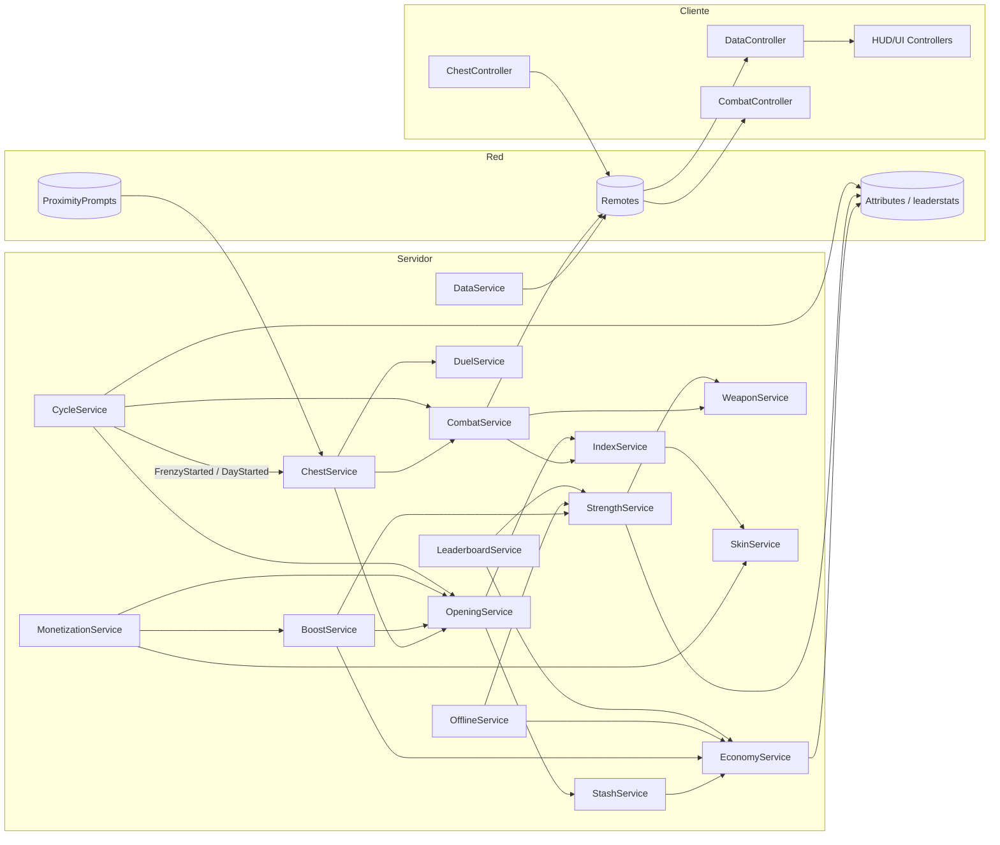
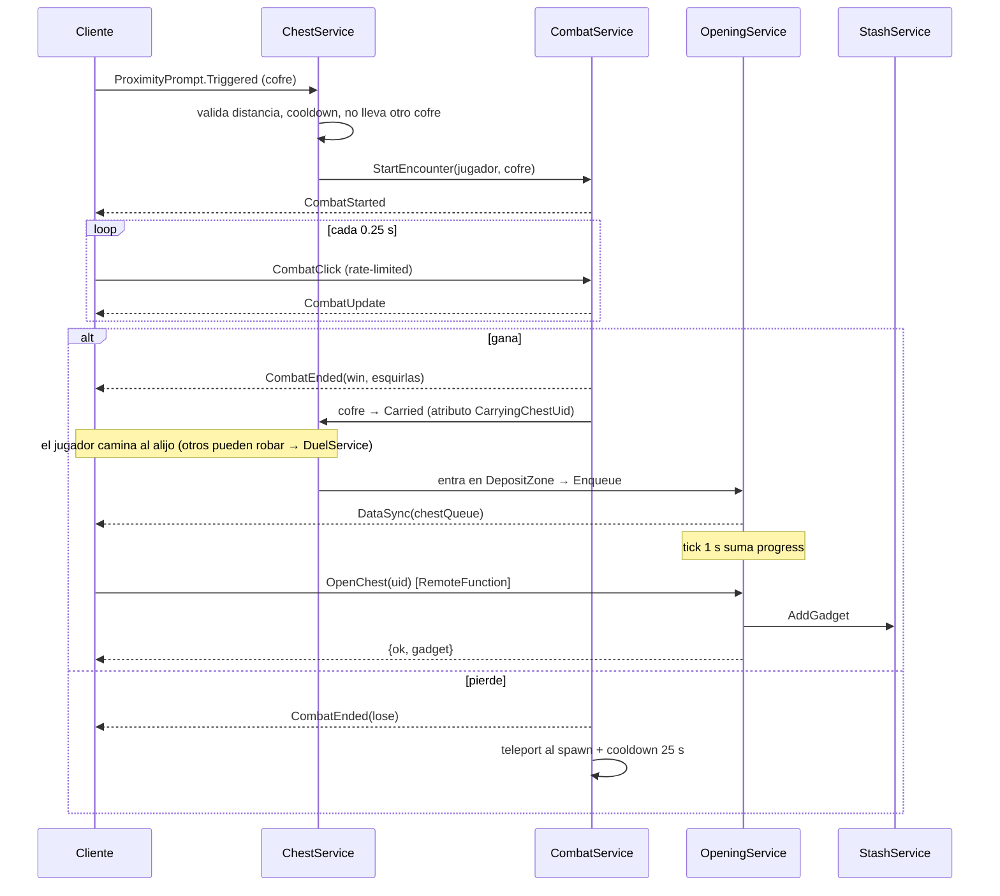
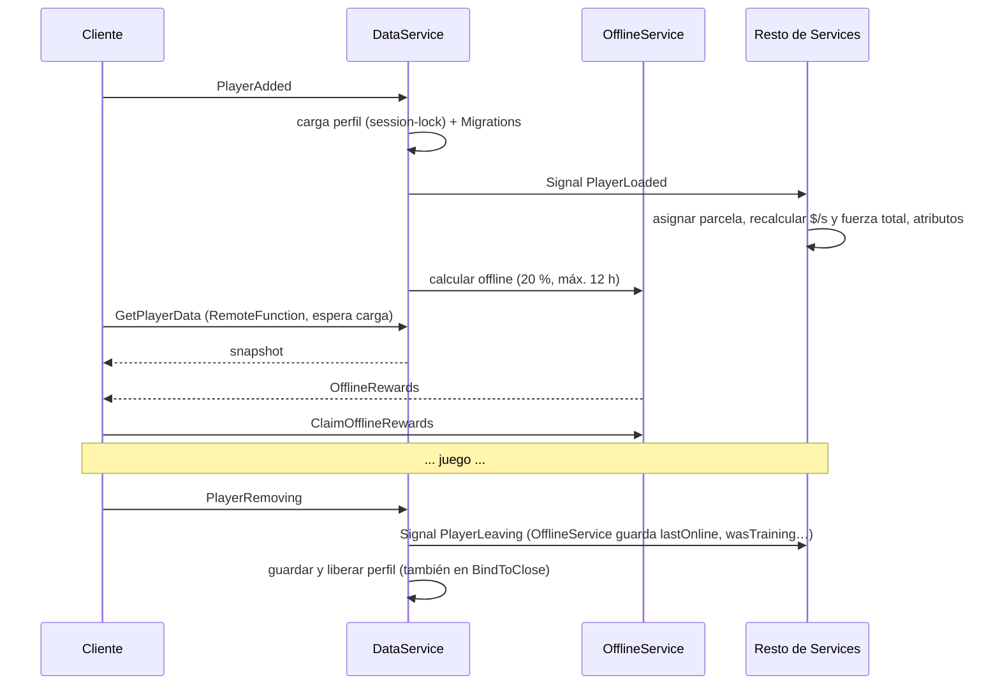
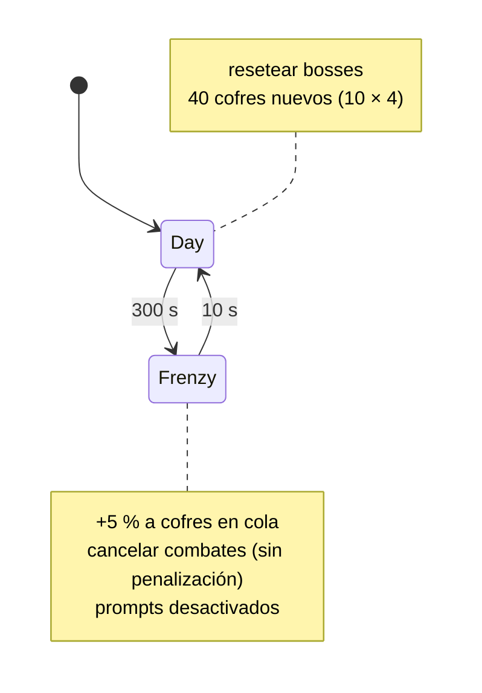

# 📐 Fase 1 — Arquitectura y estructura del proyecto
**Modelo:** Claude Opus 5.5  
**Estado:** ✅ Completado  
**Prioridad:** 🔴 Alta — hacer primero

---

## ¿Por qué Opus 5.5?
Requiere razonamiento profundo sobre sistemas interdependientes complejos. La arquitectura mal diseñada aquí rompe todo lo demás.

---

## ✅ Checklist de completitud

- [x] Estructura de carpetas en Roblox Studio definida
- [x] ServerScriptService organizado *(diseño)*
- [x] ReplicatedStorage con módulos compartidos *(diseño)*
- [ ] StarterPlayerScripts listo *(diseñado; falta crearlo)*
- [x] StarterGui estructurado *(diseño)*
- [ ] Workspace con mapa base *(jerarquía definida; se construye en Fase 2)*
- [x] Todos los RemoteEvents identificados
- [x] Todos los RemoteFunction identificados
- [x] ModuleScripts principales listados
- [x] Diagrama de comunicación cliente-servidor

---

## 🤖 Prompt para Claude

```
Eres un desarrollador experto en Roblox Studio y Luau. Necesito que diseñes 
la arquitectura completa de un juego de Roblox con las siguientes 
características generales:

CONCEPTO: Juego tipo simulator/grinder en Voxel Art donde los jugadores 
roban cofres custodiados por bosses, obtienen artilugios que generan dinero 
pasivo, entrenan fuerza y mejoran su arma progresivamente.

Diseña la estructura de carpetas y módulos del proyecto en Roblox Studio, 
incluyendo:
- ServerScriptService (scripts de servidor)
- ReplicatedStorage (módulos compartidos)
- StarterPlayerScripts (scripts de cliente)
- StarterGui (interfaces)
- Workspace (estructura del mapa)

Los sistemas principales que deben estar arquitecturados son:
1. Sistema de cofres y artilugios
2. Sistema de combate contra bosses
3. Sistema de fuerza y entrenamiento
4. Sistema de mejora de arma con esquirlas
5. Sistema de alijo y producción pasiva de dinero
6. Sistema de ciclo día/frenesí (5 min día + 10 seg frenesí)
7. Sistema AFK (dinero + fuerza offline al 20%)
8. Sistema de micropagos y skins
9. Sistema de leaderboards (fuerza y dinero/seg)
10. Sistema de índice de boss/cofres

Especifica qué es RemoteEvent, RemoteFunction o ModuleScript para cada 
componente y cómo se comunican entre sí. Dame el esquema completo antes de 
escribir ningún código.
```

---

## 📝 Resultado obtenido
*Generado por Claude Opus 5.5 — 2026-10-19. Solo esquema, sin código (como pide el prompt).*

### 0. Principios de la arquitectura

1. **Servidor autoritativo.** Dinero, fuerza, cofres, loot, combate y compras se calculan **solo** en el servidor. El cliente envía *intenciones* ("quiero abrir este cofre"), nunca resultados ("tengo 500 de dinero").
2. **Un script de arranque por lado.** `init.server.luau` y `init.client.luau` cargan *Services* (servidor) y *Controllers* (cliente). Todo lo demás son **ModuleScripts**. Nada de decenas de Scripts sueltos.
3. **Ciclo de vida `Init()` → `Start()`.** En `Init` cada módulo guarda referencias a otros (sin esperas); en `Start` conecta eventos y bucles. Así no hay problemas de orden de carga.
4. **Comunicación interna por `Signal` (módulo), no por BindableEvents.** Comunicación cliente-servidor solo por los Remotes listados en §3.
5. **Usar lo nativo antes que Remotes:** `ProximityPrompt` (se dispara en el servidor), Attributes (se replican solos), `leaderstats`, `SurfaceGui` en Workspace. Cuantos menos Remotes, menos superficie de exploits.
6. **Configuración compartida y datos separados del código.** Todos los números de balanceo viven en `Shared/Config` → la Fase 9 solo toca esos archivos.
7. **Un solo reloj de 1 s en el servidor** (`Clock`) para dinero, entrenamiento, timers de cofres y boosts. Nada de un `while true` por sistema.

---

### 1. Mapeo con Rojo (proyecto actual)

El `default.project.json` actual ya mapea `src/shared` → `ReplicatedStorage.Shared`, `src/server` → `ServerScriptService.Server` y `src/client` → `StarterPlayerScripts.Client`. Cambios a aplicar cuando empecemos a programar:

| Cambio | Motivo |
|---|---|
| Añadir `StarterGui` → `src/gui` | Las interfaces viven versionadas en el repo (como `.rbxmx` exportados de Studio o construidas por código). |
| Añadir `ServerStorage.Templates` → modelos gestionados desde Studio (`$ignoreUnknownInstances: true`) | Bosses, cofres, plantillas de parcela: solo los clona el servidor; el cliente no necesita verlos de antemano. |
| `Workspace` con `$ignoreUnknownInstances: true` y quitar el `Baseplate` del JSON | El mapa voxel se construye en Studio (Fase 2); Rojo no debe pisarlo. |
| `Packages/` con Wally (opcional) | `ProfileStore` para el guardado con session-lock. Si no queremos Wally, `DataService` envuelve un DataStore propio con la misma interfaz. |

---

### 2. Estructura completa del proyecto

```
ServerScriptService
└── Server/                          (src/server)
    ├── init.server.luau             ← Script: arranque, carga Services (Init → Start)
    ├── Services/                    ← ModuleScripts, uno por sistema
    │   ├── DataService              Carga/guarda perfil, session-lock, señales PlayerLoaded/PlayerLeaving, replicación al cliente
    │   ├── PlotService              Asigna una parcela del spawn (alijo + zona de entrenamiento) a cada jugador
    │   ├── CycleService             Máquina de estados DÍA (300 s) ↔ FRENESÍ (10 s)
    │   ├── BossService              Estado de los 10 bosses, reset en frenesí
    │   ├── ChestService             Cofres del mundo: spawn (10×4), reclamar, transportar, depositar
    │   ├── CombatService            Encuentro PvE contra boss, clics, derrota, cooldown 25 s
    │   ├── DuelService              PvP por disputa de cofre (probabilidad por fuerza)
    │   ├── OpeningService           Cola de apertura, timers, +5 % en frenesí, ABRIR → loot
    │   ├── StashService             Inventario (máx. 200), colocar/quitar artilugios, mejorar alijo
    │   ├── EconomyService           Dinero: tick 1 s, $/s, multiplicadores, API Add/Spend
    │   ├── StrengthService          Entrenamiento, fuerza entrenada/total, mejorar zona
    │   ├── WeaponService            Nivel de arma, esquirlas, multiplicador, modelo visual
    │   ├── OfflineService           AFK: calcula recompensa offline (20 %, máx. 12 h) y la entrega
    │   ├── BoostService             Boosts temporales (2x dinero, 2x fuerza, -50 % cofres)
    │   ├── MonetizationService      ProcessReceipt, GamePasses (VIP, pack de inicio)
    │   ├── SkinService              Skins de alijo, entrenamiento y arma: poseer/equipar
    │   ├── IndexService             Progreso del índice, desbloqueo de skins de arma
    │   └── LeaderboardService       OrderedDataStore, Top 100 ×2, paneles físicos cada 60 s
    └── Modules/                     ← ModuleScripts solo-servidor
        ├── ProfileTemplate          Esquema de datos del jugador (ver §5)
        ├── Migrations               Migraciones de versión del perfil
        ├── LootRoller               Tiradas ponderadas (rareza de cofre, artilugio, esquirlas)
        ├── RateLimiter              Límite de peticiones por jugador y Remote
        ├── Validate                 Validación de tipos/argumentos de Remotes
        ├── Clock                    Tick central de 1 s + utilidades de tiempo de servidor
        └── Replicator               Envía snapshot inicial y deltas de datos al cliente

ServerStorage
└── Templates/                       (gestionado en Studio)
    ├── Bosses/        Boss_01 … Boss_10
    ├── Chests/        Chest_Common, Chest_Rare, Chest_Epic, Chest_Legendary, Chest_Special
    └── Plot/          PlotTemplate (alijo nivel 1 + zona entrenamiento)  ·  StashLevels/ · TrainingLevels/

ReplicatedStorage
├── Shared/                          (src/shared)
│   ├── Config/                      ← ModuleScripts de datos puros (balanceo = Fase 9)
│   │   ├── GameConfig               Tiempos de ciclo, % AFK, límite 12 h, cooldown 25 s, inventario 200, jugadores por servidor
│   │   ├── BossConfig               10 bosses: HP, fuerza, daño, fuerza recomendada, tipo/cantidad esquirlas, paleta
│   │   ├── ChestConfig              Rarezas: peso de aparición, tiempo de apertura, multiplicador de dificultad
│   │   ├── GadgetConfig             8 artilugios por boss: id, nombre, $/s, peso por rareza de cofre
│   │   ├── WeaponConfig             Niveles 0–10: multiplicador, coste (tipo y cantidad de esquirlas)
│   │   ├── StashConfig              Niveles de alijo: slots, coste
│   │   ├── TrainingConfig           Niveles de zona: fuerza/s, coste
│   │   ├── ProductConfig            IDs de Developer Products y GamePasses + efecto de cada uno
│   │   ├── SkinConfig               Catálogo de skins (categoría, origen: Robux / evento / índice)
│   │   └── IndexConfig              Secciones del índice y recompensa de cada una
│   ├── Util/
│   │   ├── Formulas                 Fuerza total, prob. de duelo, DPS, curvas de coste (compartido: la UI previsualiza)
│   │   ├── NumberFormat             1.2K, 3.4M, 5.6B… para HUD y paneles
│   │   ├── Signal                   Señales ligeras para eventos internos
│   │   └── Types                    Tipos Luau (PlayerData, ChestEntry, Gadget…)
│   └── Net/
│       └── Remotes                  Lista ÚNICA de nombres de Remotes; el servidor los crea, el cliente los espera
├── Remotes/                         (Folder creado en runtime por el servidor a partir de Net/Remotes)
└── Assets/                          (gestionado en Studio; lo que el cliente necesita ver/usar)
    ├── Gadgets/       Modelos voxel de los 80 artilugios (alijo + animación de revelación)
    ├── Weapons/       Weapon_L0 … Weapon_L10 + Skins/
    ├── Animations/    Flexiones, ataque, celebración, evolución de arma
    ├── FX/            Partículas de frenesí, apertura, subida de nivel
    └── Sounds/

StarterPlayer
└── StarterPlayerScripts
    └── Client/                      (src/client)
        ├── init.client.luau         ← LocalScript: arranque, carga Controllers
        └── Controllers/             ← ModuleScripts
            ├── DataController           Réplica local de los datos + señal Changed(ruta)
            ├── UIController             Abre/cierra pantallas (solo un panel grande a la vez)
            ├── HUDController            Dinero, $/s, fuerza, temporizador de ciclo, botones laterales
            ├── CycleController          Cuenta atrás, efectos de FRENESÍ Y CAOS
            ├── ChestController          Panel "COFRES", timers interpolados, botón ABRIR, revelación
            ├── CarryController          Visual del cofre transportado, flecha hacia tu alijo
            ├── CombatController         UI de combate, barras de HP, clics de bonus
            ├── TrainingController       Animación de flexiones según atributo IsTraining
            ├── StashController          UI de alijo: slots, colocar/quitar, mejorar
            ├── WeaponController         UI de arma, previsualización, animación de evolución
            ├── ShopController           Tienda, PromptProductPurchase / PromptGamePassPurchase
            ├── IndexController          UI del índice
            ├── OfflineController        Popup de recompensas AFK
            └── NotificationController   Toasts ("¡Cofre robado!", "Inventario lleno"…)

StarterGui                           (src/gui) — ScreenGuis, ResetOnSpawn = false
├── HUD                Barra superior (dinero, $/s, fuerza) · temporizador de ciclo · botones laterales (COFRES, ALIJO, ARMA, TIENDA, ÍNDICE)
├── ChestsPanel        Desplegable lateral derecho: lista de cofres en cola (rareza, tiempo restante, ABRIR)
├── ChestReveal        Pantalla de revelación del artilugio
├── CombatUI           HP jugador vs boss, botón/zona de clic, resultado
├── StashUI            Grid de slots + inventario (x/200) + mejora
├── TrainingUI         Mejora de zona de entrenamiento + skins
├── WeaponUI           Nivel, multiplicador, coste en esquirlas, MEJORAR
├── ShopUI             Boosts, pack de inicio, VIP, cofre premium, skins
├── IndexUI            Bosses → cofres → artilugios con probabilidad y progreso
├── OfflinePopup       "Mientras no estabas…" + RECOGER
└── Notifications      Contenedor de toasts

Workspace
├── Map/                             (construido en Studio — Fase 2)
│   ├── Spawn/
│   │   ├── SpawnLocation
│   │   ├── Plots/       Plot_1 … Plot_8   (1 por jugador; cada uno: StashBase, StashSlots/Slot_n, TrainingPad, DepositZone, OwnerSign)
│   │   ├── Leaderboards/ StrengthBoard, MpsBoard (SurfaceGui)
│   │   └── VIPArea/     (puerta con comprobación de GamePass en servidor)
│   ├── Corridor/        Geometría del pasillo curvo
│   └── Zones/
│       └── Zone_01 … Zone_10
│           ├── BossSpawn        (Part/Attachment con atributo BossId)
│           ├── ChestSpawns/     ChestSpawn_1 … ChestSpawn_4
│           ├── Sign             (SurfaceGui: fuerza recomendada general y por rareza)
│           └── Environment/     (decoración voxel por paleta de zona)
└── Runtime/                         (lo crea el servidor; el cliente solo lo ve)
    ├── Bosses/          Bosses clonados de Templates
    └── Chests/          Cofres activos en el mundo (atributos: ChestUid, BossId, Rarity, State, ClaimantUserId)
```

---

### 3. Comunicación cliente-servidor

#### 3.1 Lo que NO es un Remote (y por qué)

| Acción | Mecanismo | Por qué |
|---|---|---|
| Reclamar cofre del mundo | `ProximityPrompt` en el cofre → `Triggered` en el servidor | El servidor recibe el evento con el jugador y comprueba distancia. Sin Remote que explotar. |
| Robar cofre a quien lo transporta | `ProximityPrompt` en el personaje portador | Igual que arriba. |
| Depositar cofre en el alijo | El servidor detecta en el tick que el portador entró en *su* `DepositZone` | El cliente no puede "fingir" que depositó. |
| Entrenar | El servidor comprueba en el tick si el `HumanoidRootPart` está dentro de *su* `TrainingPad` → atributo `IsTraining` | Sin Remote; el cliente solo anima. |
| Fase del ciclo y cuenta atrás | Atributos en `Workspace`: `CyclePhase`, `PhaseEndsAt` (con `workspace:GetServerTimeNow()`) | Se replica solo; el cliente calcula el tiempo restante localmente. |
| Datos públicos del jugador | Atributos en `Player`: `TotalStrength`, `MoneyPerSecond`, `IsTraining`, `CarryingChestUid`, `InCombat`, `CombatCooldownUntil`, `IsVIP` | Otros clientes los ven (cartel sobre la cabeza, prompts de robo). |
| Lista de jugadores | `leaderstats` (Fuerza, $/s) | Nativo de Roblox. |
| Leaderboards físicos | El servidor rellena los `SurfaceGui` del spawn | Se replican solos. |
| Comprar | Cliente llama a `MarketplaceService:Prompt…Purchase`; el servidor concede en `ProcessReceipt` / `PromptGamePassPurchaseFinished` | El flujo oficial; el cliente nunca "concede". |

#### 3.2 RemoteEvents

| Nombre | Dirección | Payload | Validación / notas | Sistema |
|---|---|---|---|---|
| `DataSync` | S → C | `{full = snapshot}` al cargar o `{path, value}` en deltas | Solo al dueño de los datos | DataService / Replicator |
| `CombatStarted` | S → C | `bossId, rarity, bossMaxHp, playerMaxHp` | — | CombatService (2) |
| `CombatUpdate` | S → C | `bossHp, playerHp` (~4 Hz) | — | CombatService (2) |
| `CombatEnded` | S → C | `result ("win"/"lose"/"cancel"), rewards {shards}` | — | CombatService (2) |
| `CombatClick` | C → S | *(nada)* | RateLimiter (máx. ~8/s), solo si `InCombat` | CombatService (2) |
| `DuelResult` | S → C | `opponentUserId, winChance, won, chestUid` | A ambos participantes | DuelService (1, 2) |
| `OfflineRewards` | S → C | `money, strength, seconds` | Se envía una vez al cargar si hay pendiente | OfflineService (7) |
| `Notify` | S → C | `kind, messageKey, params` | Toasts genéricos (compra concedida, skin desbloqueada, inventario lleno…) | Todos |

#### 3.3 RemoteFunctions

Todas devuelven `{ ok: boolean, err: string?, ...resultado }`. Todas pasan por `Validate` + `RateLimiter`. **Ninguna RemoteFunction es servidor → cliente** (es una mala práctica: el cliente puede no responder nunca y colgar el hilo del servidor).

| Nombre | Args | Devuelve | Validación en servidor | Sistema |
|---|---|---|---|---|
| `GetPlayerData` | — | snapshot completo | Espera a que el perfil esté cargado (evita la carrera "el cliente conectó tarde a DataSync") | DataService |
| `OpenChest` | `chestUid` | `gadget {uid, id}`, `shards?` | El cofre está en la cola del jugador, terminado, e inventario < 200 | OpeningService (1) |
| `PlaceGadget` | `gadgetUid, slotIndex` | nuevo `$/s` | Propiedad del artilugio, slot existe y libre según nivel de alijo | StashService (5) |
| `RemoveGadget` | `gadgetUid` | nuevo `$/s` | Está colocado | StashService (5) |
| `DiscardGadget` | `gadgetUid` | — | Propiedad, no colocado. **Necesario**: sin esto, al llegar a 200 el jugador queda bloqueado | StashService (5) |
| `UpgradeStash` | — | nuevo nivel | Dinero suficiente, no en nivel máximo | StashService (5) |
| `UpgradeTraining` | — | nuevo nivel | Dinero suficiente, no en nivel máximo | StrengthService (3) |
| `UpgradeWeapon` | — | nuevo nivel, multiplicador | Esquirlas del tipo correcto (básicas 1–5, avanzadas 6–10) | WeaponService (4) |
| `EquipSkin` | `category, skinId` | — | Skin poseída y de esa categoría | SkinService (8) |
| `ClaimOfflineRewards` | — | `money, strength` | Hay recompensa pendiente; se borra al cobrar (idempotente) | OfflineService (7) |
| `GetLeaderboard` | `boardName` | top 100 cacheado | Solo devuelve la caché (nunca llama al DataStore por petición) | LeaderboardService (9) |

**Total: 8 RemoteEvents + 11 RemoteFunctions.** Si en una fase hace falta otro, se añade primero a `Shared/Net/Remotes` (fuente única de verdad).

---

### 4. Los 10 sistemas, uno a uno

#### 1 · Cofres y artilugios — `ChestService` + `OpeningService` + `StashService`
- **Estados de un cofre del mundo:** `Guarded` (custodiado) → `InCombat` (alguien pelea con el boss) → `Carried` (alguien lo lleva) → `Stashed` (entra en la cola del jugador; desaparece del mundo y es intocable).
- **Spawn:** al acabar cada FRENESÍ, `ChestService` rellena los 4 `ChestSpawns` de cada zona. Rareza tirada con `LootRoller` usando `ChestConfig`.
- **Reclamar:** prompt → comprueba cooldown, que no esté en combate ni llevando otro cofre → si está `Guarded` llama a `CombatService:StartEncounter(player, chest)`. Si ya tiene `claimant` → `DuelService:Resolve(retador, claimant, chest)`.
- **Transportar:** al ganar al boss el cofre se suelda al personaje (`CarryingChestUid`). Se puede robar por prompt en el portador (duelo). Al entrar en su `DepositZone` → `OpeningService:Enqueue`.
- **Apertura:** cada entrada de la cola guarda `duration` y `progress` (segundos acumulados). El tick suma `1 × velocidad` (2 con boost -50 %). FRENESÍ suma `0.05 × duration`. El cliente interpola con `progress` + `rate` → el timer se ve fluido sin Remotes extra.
- **ABRIR:** `OpenChest` (RemoteFunction, porque el cliente necesita el resultado para la animación) → `LootRoller` tira el artilugio del índice de ese boss (+ posibilidad de esquirlas si es `Special`) → `StashService:AddGadget` → `IndexService:RecordGadget`.
- **Artilugios:** cada uno tiene `uid` único (varios iguales cuentan por separado). Solo los colocados en slots del alijo producen.

#### 2 · Combate contra bosses — `BossService` + `CombatService` + `DuelService`
- El boss es un modelo estático compartido en la zona; **cada encuentro es individual** (instancia de combate por jugador, simulada en el servidor).
- **Simulación** (tick 0.25 s): `daño jugador = Formulas.PlayerDps(TotalStrength)` + bonus por clics validados (pequeño, con tope); `daño boss = BossConfig.dps × ChestConfig.difficultyMult[rareza]`. Se envía `CombatUpdate`.
- **Victoria:** esquirlas (`basic` boss 1–5, `advanced` 6–10, cantidad según `BossConfig`) → `WeaponService:AddShards`; cofre a `Carried`; `IndexService:RecordBossKill`.
- **Derrota:** el servidor teletransporta al spawn, `CombatCooldownUntil = ahora + 25`. Sin pérdidas. El cofre vuelve a `Guarded`.
- **Duelo PvP:** instantáneo. `P(gana A) = FuerzaA / (FuerzaA + FuerzaB)` en `Formulas` (ajustable en Fase 9). El perdedor solo pierde el cofre; el retador recibe un anti-spam corto (ej. 5 s) para que no se reintente en bucle.

#### 3 · Fuerza y entrenamiento — `StrengthService`
- Tick 1 s: si el jugador está dentro de su `TrainingPad` → `IsTraining = true`, `trainedStrength += TrainingConfig[nivel].rate × boost2x`.
- `TotalStrength = trained + trained × WeaponConfig[nivel].multiplier` (`Formulas.TotalStrength`). Se recalcula al cambiar fuerza o arma y se publica en el atributo + `leaderstats`.
- `TrainingController` (cliente) reproduce la animación de flexiones cuando cambia `IsTraining` en su propio personaje (las animaciones del propio personaje se replican solas).

#### 4 · Mejora de arma — `WeaponService`
- Datos: `weapon.level` (0–10), `shards.basic`, `shards.advanced`.
- `UpgradeWeapon`: niveles 1–5 cuestan esquirlas básicas, 6–10 avanzadas; coste exponencial desde `WeaponConfig`.
- Visual: el servidor equipa en el personaje el modelo `Assets/Weapons/Weapon_L{n}` (o la skin equipada). El cliente reproduce la animación de evolución al recibir el delta de `weapon.level`.

#### 5 · Alijo y producción pasiva — `StashService` + `EconomyService`
- `StashService` mantiene `gadgets` (máx. 200) y `stash.placed[slot] = gadgetUid`; slots según `StashConfig[nivel]`.
- Cada cambio en el alijo recalcula `MoneyPerSecond = Σ mps × (2 si boost) × (1.1 si VIP)` y lo cachea (no se suma cada segundo artículo por artículo).
- `EconomyService`, en el tick de 1 s: `money += MoneyPerSecond`. Única puerta para gastar: `EconomyService:Spend(player, cantidad)` (atómico, devuelve true/false).
- Visual: el servidor coloca los modelos de artilugios en los `StashSlots` de la parcela y cambia el modelo del alijo según nivel/skin.

#### 6 · Ciclo día/frenesí — `CycleService`
- Máquina de estados: `Day (300 s)` → `Frenzy (10 s)` → `Day`. Publica `CyclePhase` y `PhaseEndsAt` en Workspace y emite las señales `FrenzyStarted` / `DayStarted`.
- **Al empezar FRENESÍ:** `OpeningService` suma +5 % a todos los cofres en cola de los jugadores conectados; `CombatService` cancela los encuentros en curso (sin penalización); los prompts de cofres se desactivan.
- **Al empezar DÍA:** `BossService` resetea los bosses; `ChestService` reemplaza los cofres `Guarded` por 40 nuevos. Los cofres `Carried` se respetan.

#### 7 · AFK — `OfflineService`
- **Al salir** (`PlayerLeaving`, antes del guardado): guarda `lastOnline`, `wasTraining`, `mpsAtLogout`, `trainRateAtLogout`.
- **Al entrar:** `t = min(ahora − lastOnline, 12 h)`; `money = mpsAtLogout × 0.2 × t`; `strength = wasTraining ? trainRateAtLogout × 0.2 × t : 0`. Se guarda como `offline.pending` (sobrevive a un crash) y se envía `OfflineRewards`.
- `ClaimOfflineRewards` lo suma y borra `pending`. Los boosts no se aplican offline.
- Se usa `os.time()` (reloj del servidor), nunca la hora del cliente.

#### 8 · Micropagos y skins — `MonetizationService` + `BoostService` + `SkinService`
| Producto | Tipo en Roblox | Efecto |
|---|---|---|
| 2x Dinero (1 h) | Developer Product | `BoostService:Add("money2x", 3600)` |
| 2x Fuerza (1 h) | Developer Product | `BoostService:Add("strength2x", 3600)` |
| -50 % tiempo cofres (1 h) | Developer Product | `BoostService:Add("chestSpeed", 3600)` |
| Pack de inicio | **GamePass** (compra única garantizada por Roblox) | Al detectar posesión por primera vez: boosts + skin exclusiva; flag `starterPackGranted` |
| VIP permanente | GamePass | `IsVIP`, +10 % $/s, puerta de `VIPArea` |
| Cofre Premium | Developer Product | `OpeningService:Enqueue` de un cofre `Premium` con artilugios exclusivos |
| Skins alijo/entrenamiento | Developer Product por skin | `SkinService:Grant` |
- `ProcessReceipt`: solo concede si el perfil está cargado; guarda los `PurchaseId` procesados en el perfil para no conceder dos veces; devuelve `PurchaseGranted` **solo después** de escribir en el perfil.
- Boosts: guardan *segundos restantes* que el tick descuenta **solo mientras el jugador está conectado** (comprar 1 h = 1 h de juego). Comprar otro igual suma tiempo.

#### 9 · Leaderboards — `LeaderboardService`
- Dos `OrderedDataStore`: `Strength_v1` y `Mps_v1`. Cada 60 s: escribe los valores de los jugadores del servidor y lee el Top 100; actualiza los `SurfaceGui` del spawn y la caché de `GetLeaderboard`.
- **Ojo:** OrderedDataStore solo guarda enteros (hasta ~2⁵³). En un simulator los números crecen sin límite → se guarda un valor codificado (logarítmico) y se decodifica al mostrar. Se define en `Formulas`.
- Respetar el presupuesto de DataStore: escrituras escalonadas y `pcall` con reintentos.

#### 10 · Índice de bosses/cofres — `IndexService`
- Datos: `index.gadgets[gadgetId] = veces obtenido`, `index.bossKills[bossId]`, `index.claimed[sectionId]`.
- La UI lee las probabilidades directamente de `Shared/Config` (son públicas) y el progreso de `DataController`.
- Al completar una sección (p. ej. los 8 artilugios de un boss) → `SkinService:Grant(weaponSkin)` + `Notify`.

---

### 5. Esquema de datos del jugador (`ProfileTemplate`)

```
version             número (para Migrations)
money               número
trainedStrength     número
shards              { basic, advanced }
weapon              { level }
training            { level }
stash               { level, placed = { [slot] = gadgetUid } }
gadgets             { [gadgetUid] = { id, bossId, obtainedAt } }      -- máx. 200
chestQueue          { { uid, bossId, rarity, duration, progress } }
boosts              { money2x = segRestantes, strength2x = …, chestSpeed = … }
skins               { owned = { [skinId] = true }, equipped = { stash, training, weapon } }
index               { gadgets = { [gadgetId] = n }, bossKills = { [bossId] = n }, claimed = { [sectionId] = true } }
offline             { lastOnline, wasTraining, mpsAtLogout, trainRateAtLogout, pending? }
purchases           { processedIds = { …últimos N… } }
flags               { starterPackGranted, tutorialDone }
```
`TotalStrength` y `MoneyPerSecond` **no se guardan**: se derivan al cargar (así un cambio de balanceo se aplica a todos automáticamente).

---

### 6. Diagramas de comunicación

#### 6.1 Dependencias entre módulos



#### 6.2 Flujo principal: reclamar → combate → transportar → depositar → abrir



#### 6.3 Entrada del jugador, AFK y salida



#### 6.4 Ciclo DÍA / FRENESÍ



---

### 7. Seguridad y anti-exploit (reglas para todas las fases)

- Todo argumento de Remote se valida (`typeof`, rangos, existencia, propiedad).
- `RateLimiter` en cada Remote C→S; quien lo supere repetidamente se ignora y se registra.
- Distancias y regiones (cofres, depósito, entrenamiento, VIP) se comprueban en el servidor.
- El cliente **nunca** envía cantidades de dinero, fuerza, esquirlas ni resultados de combate.
- Cada gasto pasa por `EconomyService:Spend` / `WeaponService:SpendShards`, que comprueban y descuentan en una sola operación.
- Guardado: autosave cada ~60 s + al salir + `game:BindToClose`. Session-lock para evitar duplicados al cambiar de servidor.

---

### 8. Orden de implementación recomendado

1. **Base técnica:** bootstrap, `Signal`, `Clock`, `Net/Remotes`, `DataService` + `ProfileTemplate`, `DataController`, HUD mínimo.
2. **Fase 2:** mapa con la jerarquía de §2 (los nombres de carpetas son el contrato con el código).
3. **Fase 3–4:** `CycleService` → `ChestService` → `CombatService`/`DuelService` → `OpeningService` → `StashService`.
4. **Fase 5–6:** `EconomyService`, `StrengthService`, `WeaponService`, `OfflineService`.
5. **Fase 7:** `BoostService`, `MonetizationService`, `SkinService`, `IndexService`, `LeaderboardService`.
6. **Fase 8–9:** pulido y balanceo (solo `Shared/Config` + `Formulas`).

---

### 9. ✅ Decisiones confirmadas

*Confirmadas por el desarrollador el 2026-10-19. Estas son las decisiones definitivas para todas las fases siguientes.*

| # | Decisión | ✅ Confirmado |
|---|---|---|
| 1 | **Zona de entrenamiento** | Cada jugador tiene su propia zona dentro de su **parcela personal** |
| 2 | **Robo de cofres en transporte** | ❌ No se pueden robar mientras se transportan — solo se disputan **al reclamarlos** |
| 3 | **Timers offline** | ✅ Avanzan offline, pero **sin el bonus de frenesí** (+5% al acabar los 5 min de día) |
| 4 | **Apertura de cofres** | ✅ **En paralelo** (varios cofres a la vez) |
| 5 | **Boosts** | ⏸️ Cuentan **tiempo jugado** — el reloj se pausa cuando el jugador está desconectado |
| 6 | **Frenesí (10 s)** | 🚫 Sin combate — todos los jugadores son teletransportados al spawn, los cofres de bosses se regeneran durante esos 10 segundos |
| 7 | **Inventario lleno (200)** | 🔒 Se **bloquea abrir** más cofres/huevos — el jugador debe descartar artilugios primero |
| 8 | **Jugadores por servidor** | 👥 **6 jugadores** por servidor (= 6 parcelas) |

---

## 🔍 Revisión
- [x] Revisado y correcto
- [ ] Aplicado en Roblox Studio

**Notas:**
- Arquitectura diseñada por Claude Opus 5.5 el 2026-10-19
- Decisiones confirmadas por el desarrollador el 2026-10-19
- Listo para pasar a Fase 2 (Mapa Voxel Art — Claude Sonnet 5.5)
